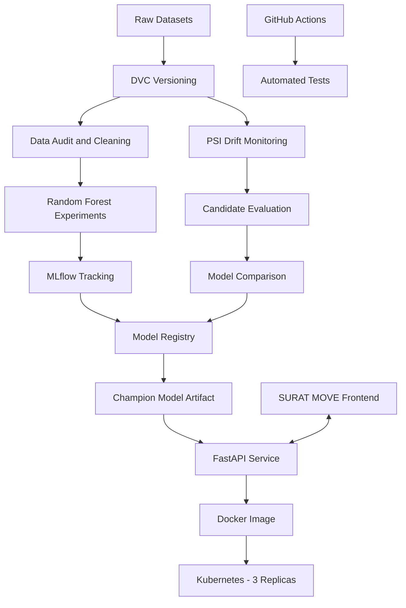

# SURAT MOVE - City Bus Delay Prediction

An end-to-end MLOps project for predicting city bus delays in Surat, India.

## Project Information

- Group ID: G141
- Problem ID: MP249
- Faculty: Ravi Pratap
- Batch: 39
- Application: SURAT MOVE
- Production Model: Random Forest Regressor, Version 2

## Team Members

| Name | Enrollment Number |
|---|---|
| Akshansh Bansal | S24CSEU1714 |
| Harit Hura Singh | S24CSEU0748 |
| Anubhav Singh Chauhan | S24CSEU1913 |
| Devansh Luthra | S24CSEU1706 |
| Tanishq Gupta | S24CSEU1696 |

## Project Overview

SURAT MOVE predicts bus delays in minutes using historical bus operation data, route characteristics, passenger demand, weather conditions and driver experience.

The project demonstrates the machine learning lifecycle from data auditing and preprocessing to model training, experiment tracking, deployment, drift monitoring and controlled model promotion.

## Technology Stack

| Component | Technology |
|---|---|
| Programming | Python 3.12 |
| Data Processing | Pandas, NumPy |
| Machine Learning | Scikit-learn |
| Data Versioning | DVC, Google Drive |
| Experiment Tracking | MLflow, SQLite |
| Backend | FastAPI, Uvicorn |
| Frontend | HTML, CSS, JavaScript |
| Containerization | Docker, Docker Compose |
| Orchestration | Kubernetes |
| Continuous Integration | GitHub Actions |
| Automated Testing | Pytest |
| Drift Monitoring | Population Stability Index |
| Version Control | Git, GitHub |

## System Architecture



Detailed architecture: [Architecture Documentation](docs/architecture.md)

## Stage 1 - Data Audit and Versioning

The original training dataset contains 1056 records.

| Data Quality Issue | Finding |
|---|---|
| Duplicate rows | 56 |
| Sentinel values | 55 raw occurrences of -1 in stops |
| Target leakage | delay_logged_by_conductor |
| Unit mixup | Not detected |
| Stuck sensor | Not detected |
| Target typos | Not detected |
| Spelling variants | Not detected |

After duplicate removal, 1000 unique training records remain.

The leaking column is excluded from model training. Invalid stop values are handled during preprocessing.

Training and later datasets are tracked using DVC.

```bash
dvc pull
dvc status
dvc status -c
```

Google Drive remote access requires appropriate permissions.

## Stage 2 - Model Training and Experiment Tracking

The model uses six numerical and two categorical features.

| Feature | Type |
|---|---|
| route_km | Numerical |
| stops | Numerical |
| passengers | Numerical |
| hour | Numerical |
| temp_c | Numerical |
| driver_exp_yr | Numerical |
| weather | Categorical |
| depot_zone | Categorical |

Prediction target: delay_min.

Preprocessing includes numerical median imputation and categorical one-hot encoding.

Random Forest experiments use a chronological 80/20 training and validation split.

### Experiment Results

| Trees | Maximum Depth | Validation MAE |
|---|---|---|
| 100 | 8 | 1.4030 |
| 200 | 12 | 1.4055 |
| 300 | 16 | 1.4076 |

The 100-tree, depth-8 configuration achieved the lowest validation MAE.

### MLflow Registry

- Experiment: MP249_Bus_Delay_Prediction
- Registered Model: Surat_Bus_Delay_Predictor_Final
- Champion Alias: Version 2
- Tracking Database: mlflow.db

The final five experiment and registration runs record the original training dataset SHA256 hash.

### Model Artifacts

- models/model.joblib: deployed champion model
- registry_artifacts/v1/: exported version 1
- registry_artifacts/v2/: exported version 2

Both exported MLflow models were successfully loaded locally.

## Stage 3 - API and Deployment

The FastAPI service exposes the following endpoints.

| Endpoint | Method | Purpose |
|---|---|---|
| / | GET | API information |
| /health | GET | Service health |
| /predict | POST | Bus delay prediction |
| /app/ | GET | SURAT MOVE website |
| /docs | GET | Interactive API documentation |

### Example Request

```json
{
  "route_km": 15.5,
  "stops": 12,
  "passengers": 45,
  "hour": 9,
  "temp_c": 32,
  "driver_exp_yr": 20,
  "weather": "clear",
  "depot_zone": "North"
}
```

### Verified Response

```json
{
  "predicted_delay_minutes": 13.62,
  "model": "RandomForestRegressor",
  "model_version": "2"
}
```

The API validates input using Pydantic and rejects invalid values with HTTP 422.

Prediction events are written as structured JSON logs to standard output.

## Stage 4 - Drift Detection and Retraining

Population Stability Index (PSI) is used to compare training and later data distributions.

Drift threshold: 0.25.

| Feature | PSI |
|---|---:|
| route_km | 0.055797 |
| stops | 0.032780 |
| passengers | 0.027756 |
| hour | 0.046560 |
| temp_c | 0.019914 |
| driver_exp_yr | 4.474153 |

The most drifted feature is driver_exp_yr.

### Group-wise Performance

Version 1 MAE on the later dataset:

| Depot Zone | MAE |
|---|---:|
| North | 6.4698 |
| South | 5.1190 |
| East | 4.9171 |

North is the worst-served group.

### Retraining Results

Version 1 was trained on the cleaned original dataset.

Version 2 incorporates the first 70 percent of the chronologically ordered later dataset.

Both models were evaluated on the remaining 30 percent of the later dataset.

| Metric | Version 1 | Version 2 |
|---|---:|---:|
| Check-set MAE | 5.2242 | 1.9339 |

MAE reduction: 62.98 percent.

Promotion decision: Version 2 promoted to champion.

The original experiment validation MAE and later check-set MAE represent different evaluation datasets.

### Holdout Predictions

250 predictions were generated.

Output: predictions/holdout_predictions.csv

The output contains record_id and prediction columns, with no missing predictions or duplicate record IDs.

## Local Installation

Clone the repository:

```bash
git clone https://github.com/DevanshLuthra/MP249-Bus-Delay.git
cd MP249-Bus-Delay
```

Create a Python environment on Windows:

```powershell
py -3.12 -m venv .venv
.\.venv\Scripts\Activate.ps1
python -m pip install -r requirements.txt
```

Start the API:

```bash
python -m uvicorn app.main:app --host 0.0.0.0 --port 8000
```

Open:

- Website: http://localhost:8000/app/
- Swagger: http://localhost:8000/docs
- Health: http://localhost:8000/health

The deployed model artifact is sufficient for inference. Training datasets are required for data analysis and retraining.

## Data and Training Commands

Run from the repository root.

```bash
dvc pull
python -m src.audit_data
python -m src.clean_data
python -m src.psi_monitor
```

Training entry point:

```bash
python -m src.train_experiments
```

Model registration and retraining entry point:

```bash
python -m src.register_models
```

The registration script is intended for a fresh final registry. It protects existing registered versions against accidental duplication.

Generate holdout predictions using the current configured deployment artifact:

```bash
python -m src.predict_holdout
```

## MLflow Dashboard

```bash
mlflow ui --backend-store-uri sqlite:///mlflow.db --port 5000
```

Open http://localhost:5000.

Portable model loading:

```python
import mlflow

model = mlflow.pyfunc.load_model("registry_artifacts/v2")
```

## Docker Deployment

```bash
docker compose build
docker compose up -d
docker compose ps
```

- Image: mp249-api:1.0
- Container Port: 8000
- Host Port: 8001

Website: http://localhost:8001/app/

View logs:

```bash
docker compose logs
```

Stop the application:

```bash
docker compose down
```

## Kubernetes Deployment

The local Kubernetes configuration uses:

- Deployment: mp249-api
- Service: mp249-svc
- Replicas: 3
- Service Type: ClusterIP
- Service Port: 80
- Container Port: 8000
- Readiness and liveness health probes

The image must be available in the Kubernetes node runtime because imagePullPolicy is Never.

For the tested Docker Desktop configuration, using Windows PowerShell:

```powershell
docker save -o mp249-api-1.0.tar mp249-api:1.0
cmd.exe /c "docker exec -i desktop-control-plane ctr -n k8s.io images import --platform linux/amd64 - < mp249-api-1.0.tar"
```

Apply the manifests:

```bash
kubectl apply -f k8s/deployment.yaml
kubectl apply -f k8s/service.yaml
kubectl rollout status deployment/mp249-api
kubectl get pods -l app=mp249-api
```

Forward the service:

```bash
kubectl port-forward service/mp249-svc 8005:80
```

Website: http://localhost:8005/app/

Final local verification confirmed three ready replicas, zero pod restarts, successful health checks, prediction requests and JSON logging.

## Monitoring

Run the PSI monitoring script:

```bash
python scripts/monitor_drift.py
```

Monitoring outputs:

- reports/psi_report.json
- reports/monitoring_history.csv
- logs/drift_monitor.log
- logs/drift_alerts.log

The monitoring script detects drift and generates alerts without automatically replacing the champion model.

## Automated Testing and CI

```bash
python -m pytest tests/ -v
```

Latest verified local result: 16 passed, 0 failed.

GitHub Actions workflow:

.github/workflows/ci.yml

The workflow installs dependencies and runs pytest on configured push and pull request events.

[GitHub Actions](https://github.com/DevanshLuthra/MP249-Bus-Delay/actions)

## Repository Structure

```text
MP249-Bus-Delay/
    app/
    src/
    frontend/
    tests/
    data/
        raw/
    models/
    registry_artifacts/
    predictions/
    reports/
    scripts/
    docs/
    k8s/
    .github/workflows/
    .dvc/
    Dockerfile
    compose.yaml
    requirements.txt
    params.yaml
    mlflow.db
    findings.yaml
    GROUP.md
    README.md
```

## Known Limitations

- Five historical MLflow runs predate the final dataset-hash logging implementation and do not contain data_sha256.
- The original MLflow database contains machine-specific artifact paths. Exported models can be loaded independently, but registry alias loading on another machine requires artifact-path migration.
- Changing the MLflow champion alias does not automatically replace the deployed model artifact.
- Scheduled Windows monitoring is currently disabled.
- The final monitoring script generates alerts; future candidate retraining and deployment require manual evaluation.
- Kubernetes deployment was verified on a local Docker Desktop cluster, not a public cloud.
- Older training and statistical drift scripts are retained for historical reference. The final workflow uses the experiment, registration and PSI modules described above.

## Future Improvements

- Live GPS and traffic data integration
- Cloud-based deployment
- Centralized monitoring dashboards
- Portable MLflow artifact storage
- Automated candidate evaluation with deployment approval
- Model and data quality monitoring

## Conclusion

SURAT MOVE demonstrates an end-to-end academic MLOps implementation with reproducible data management, experiment tracking, model registration, API deployment, container orchestration, automated testing and drift-based model improvement.
