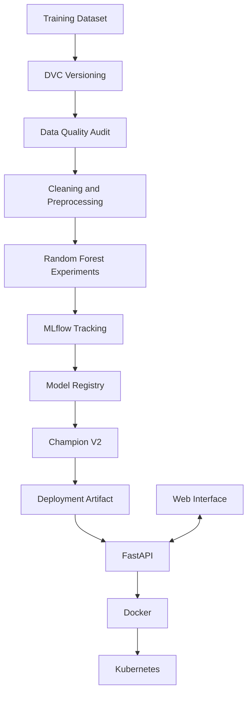
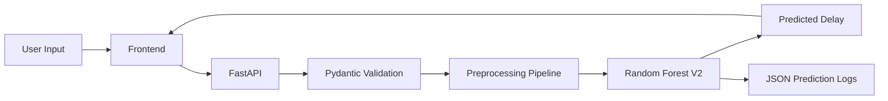
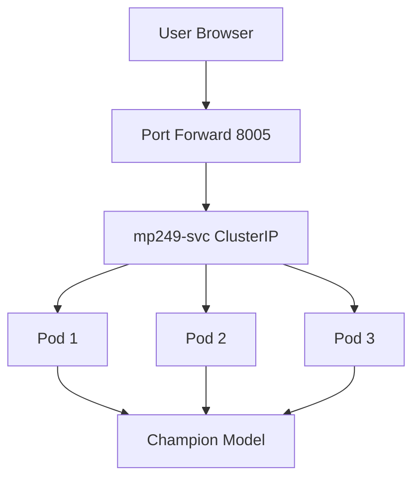
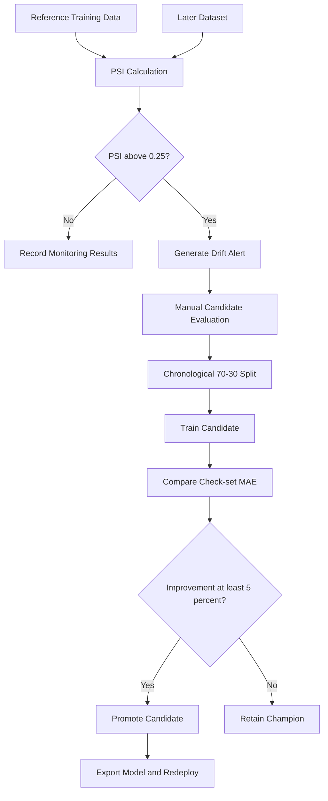
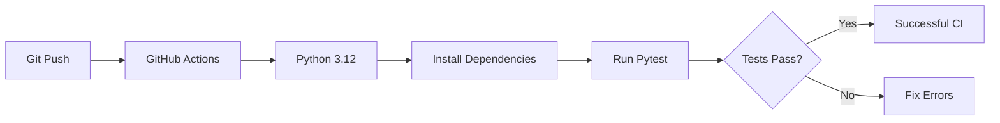

# MP249 - System Architecture

## 1. End-to-End MLOps Pipeline

## 2. Prediction Architecture

## 3. Kubernetes Architecture

Each pod runs the mp249-api:1.0 image on port 8000.

Readiness and liveness probes use the /health endpoint.

## 4. Drift and Retraining Architecture

Monitoring does not automatically trigger model replacement.

## 5. Continuous Integration

## 6. Implementation Components

| Component | Implementation |
|---|---|
| Configuration | params.yaml |
| Data audit | src/audit_data.py |
| Data cleaning | src/clean_data.py |
| Experiment tracking | src/train_experiments.py |
| Model registration | src/register_models.py |
| Drift detection | src/psi_monitor.py |
| Monitoring alerts | scripts/monitor_drift.py |
| Holdout prediction | src/predict_holdout.py |
| API entry point | app/main.py |
| API implementation | src/api.py |
| Frontend | frontend/ |
| Deployment artifact | models/model.joblib |
| Containerization | Dockerfile |
| Orchestration | k8s/ |
| Continuous integration | .github/workflows/ci.yml |

## 7. Verified Deployment Results

- Champion model: Version 2
- Docker image: mp249-api:1.0
- Kubernetes deployment: mp249-api
- Kubernetes service: mp249-svc
- Ready replicas: 3
- Pod restarts at final verification: 0
- Automated tests: 16 passed
- Example prediction: 13.62 minutes
- Check-set MAE improvement: 62.98 percent

## 8. Deployment Controls

Model promotion and application deployment are separate operations.

A registry alias change does not automatically update the deployed model file.

The deployed artifact must be updated and the container rebuilt before deploying a new model version.

Historical MLflow artifact paths are machine-specific. Portable model exports are provided separately.
